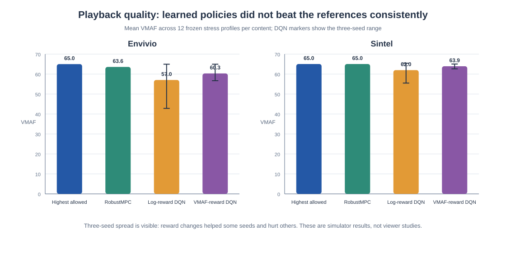
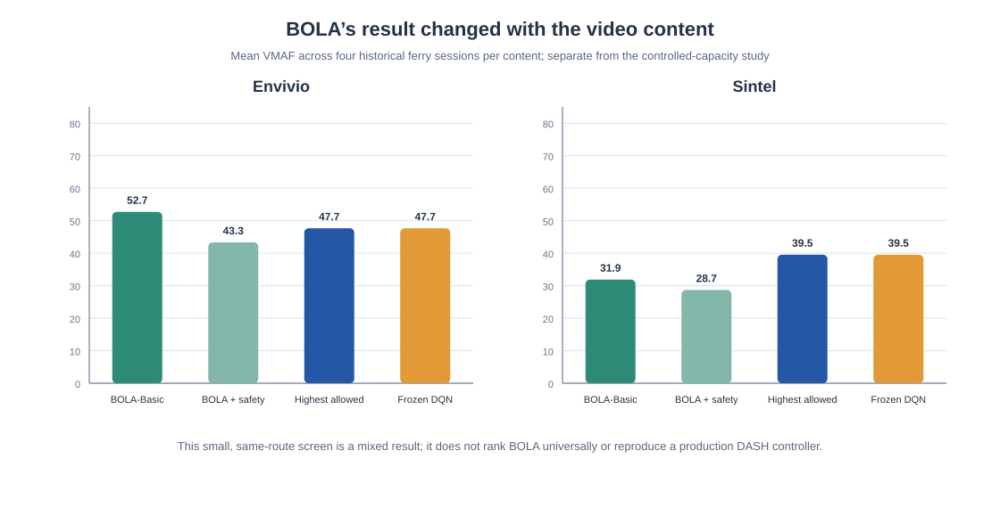
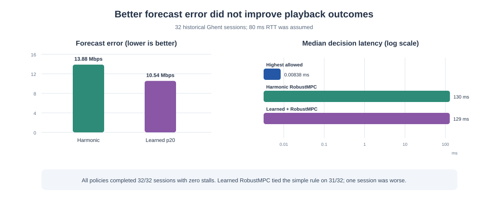

# crealet — ABR Decision Engine

**crealet** is a research prototype for adaptive bitrate (ABR) video streaming.
It includes a trace-driven simulator, neural ABR policies, classical controllers,
offline evaluation tools, and a local browser player.

The project asks whether a learned policy or throughput predictor can improve
video quality without increasing startup delay or rebuffering.

> crealet is the repository and project name. The main learned policy uses a
> Candidate Transformer with Dueling Double DQN; crealet is not a separate model
> architecture.

**Current finding:** the learned approaches did not show a repeatable playback
gain over the highest-allowed rule in the tested scenarios. This is a result
about this prototype and its datasets; it does not show that neural networks
cannot work for ABR in general.

[Results](#results) · [How it works](#how-it-works) · [Run locally](#run-locally) · [Data and limits](#data-and-limits) · [Research notes](#research-notes)


*System overview. This is an explanatory diagram, not a benchmark result or a
browser screenshot.*

## Results

| Experiment | Main result | Scope |
| --- | --- | --- |
| [DQN reward comparison](docs/research/controlled_capacity_transfer.md) | Mean VMAF: reward-trained DQN 60.32 vs. highest-allowed 64.99 on Envivio; 63.92 vs. 65.03 on Sintel | Three seeds; synthetic controlled-capacity profiles; two videos |
| [BOLA and DQN screen](docs/research/single_task_vod_study.md) | BOLA-Basic was 5.03 VMAF points higher than highest-allowed on Envivio and 7.65 lower on Sintel; the frozen DQN matched the rule | Four historical ferry sessions per video |
| [Throughput predictor](docs/research/throughput_predictor_study.md) | Forecast MAE fell from 13.88 to 10.54 Mbps over 1,568 decisions; playback tied highest-allowed on 31/32 sessions and was lower on one | 32 historical Ghent sessions; assumed 80 ms RTT |

These are observed results, not statistical significance claims. The studies do
not establish broad network generalization or that neural ABR is generally
unreliable. **The current decision is to pause model training and promotion**
until new measured traces include recorded RTT and sustained throughput near or
below the video bitrate ladder.

In the measured-trace predictor study, forecast error improved without a
corresponding playback gain: the bitrate ladder was already saturated on most
sessions. This project-specific result is a reminder to evaluate the controller
outcome as well as prediction error.

The comparisons below come from different studies and test sets. Read each
caption and linked report before comparing their numbers.



*Controlled-capacity VMAF comparison. DQN whiskers show the observed range
across three seeds, not confidence intervals.*



*Separate historical-route VOD screen.* BOLA-Basic scored higher than
highest-allowed on Envivio and lower on Sintel. Adding the safety filter lowered
its mean VMAF on both. The frozen DQN exactly matched the rule. The full protocol
and limits are in the [VOD quality study](docs/research/single_task_vod_study.md).



*Measured-trace predictor diagnostic.* All policies completed without stalls;
the high-service traces often left little room for a different bitrate decision.

For the training-budget result and full methods, see the [training-budget
comparison](docs/research/training_budget_decision.md) and the linked study
reports. BOLA and RobustMPC are useful reference controllers; these experiments
do not show that they are ineffective.

## Reproducing the README figures

The comparison figures are generated from the committed experiment summaries:

```bash
python scripts/render_readme_figures.py
```

The renderer uses only the Python standard library. It reads the VMAF summaries
from [`runs/vmaf-reward-stress-transfer-v1/vmaf/vmaf_transfer.json`](runs/vmaf-reward-stress-transfer-v1/vmaf/vmaf_transfer.json)
and [`runs/single-task-vod-v1/vmaf_transfer.json`](runs/single-task-vod-v1/vmaf_transfer.json),
and the predictor report from [`runs/throughput-predictor-v1/ghent-measured-results.json`](runs/throughput-predictor-v1/ghent-measured-results.json).

## How it works

1. **Observe:** the default DQN path collects eight recent download rows, five
   player-state values, public stream settings, and the available representations.
2. **Score:** the frozen Dueling Double DQN returns one action value per bitrate.
3. **Filter and choose:** an observed-goodput rule masks higher bitrates before
   taking the highest remaining score. The lowest bitrate remains available.
4. **Download and play:** request the selected segment, advance the buffer and
   playback clocks, and record startup, stalls, played quality, and bytes.
5. **Repeat:** use the new measurements for the next segment decision.

The default action filter requires at least 12 seconds of buffered video before
higher bitrates are eligible. It limits their nominal bitrate to 0.65 times the
harmonic mean of recent measured goodput. This is a heuristic, not a stall guarantee.

Optional VOD request recovery can cancel a slow higher-quality body and retry
that same segment at the lowest quality. It allows at most four retries per
segment. Failed bodies are discarded in full; RTT, backoff, bytes and stalls all
count. Recovery is available in the simulator and opt-in in the native player
with `--enable-request-recovery`. See [native recovery](docs/native-recovery.md)
and the [initial simulator experiment](docs/request-recovery.md).

### Model and training

The current baseline uses a **77,826-parameter Candidate Transformer**:

```text
History [8,5] ──────────────────────────────┐
Player state [5] + stream settings [10] ────┼─> 64-wide tokens
Bitrate candidates [K,3] ──────────────────┘          │
                                      2 Transformer encoder layers
                                      4 attention heads, FFN 128
                                                    │
                                state value V(s) + candidate advantages A(s,a)
                                                    │
                                Q(s,a) = V(s) + A(s,a) - mean(A)
                                                    │
                                observed-goodput mask -> argmax -> bitrate
```

The mean uses valid candidates only. Candidate inputs contain nominal bitrate,
estimated segment size, and duration. Future trace bandwidth is not a model input.
Optional queue-summary features are a separate research variant and are not enabled
in the native player. Dense, GRU and PPO architectures remain available for comparison.

Dueling Double DQN trains from stored transitions. The online network chooses
the next action; a separate target network scores it for the learning target.
Training periodically refreshes the target network and evaluates checkpoints
on validation traces. Playback uses frozen weights and does not update them online.
The reward uses played log bitrate with explicit penalties, including stalls;
recent experiments use a rebuffer penalty of 12. Bitrate is a quality proxy,
not measured visual quality or a human opinion score.

Current browser/recovery experiments load
[`runs/learning-ablation/baseline-seed-7/accepted.npz`](runs/learning-ablation/baseline-seed-7/accepted.npz).
Its tensors exactly match the earlier accepted controller; see
[checkpoint identity](runs/learning-ablation/control_identity.json).
NPZ checkpoints disable pickle loading and validate model source, shapes and
feature contracts. Changing model code can require explicit checkpoint migration.

## Run locally

Python 3.12 is the currently verified environment. PyTorch is optional for
simulation-only work and required for model training, inference, and the
predictor evaluation.

```bash
python3 -m venv .venv
source .venv/bin/activate
python -m pip install -r requirements-dev.txt -r requirements-model.txt
python -m pytest -q
```

To replay the measured-trace predictor comparison, run:

```bash
python -m scripts.evaluate_measured_throughput_predictor
```

This uses the frozen predictor and historical Ghent traces. It checks the
recorded protocol and file hashes, then writes the evaluation report under
`runs/throughput-predictor-v1/`. See the [predictor study](docs/research/throughput_predictor_study.md)
for its assumptions and reuse limits.

Replay the recent experiments with the recorded datasets and frozen checkpoint:

```bash
python -m scripts.evaluate_request_recovery
python -m scripts.prepare_buffer_experiment
python -m scripts.evaluate_buffer_experiment
```

The buffer preparation command reuses the committed raw traces. If a raw file
is missing, it downloads it from the original archive. These commands overwrite
the corresponding reproducible reports under `runs/`; they do not retrain the model.

For an environment-only diagnostic:

```bash
python -m abr.benchmark --dataset data/hard_envivio/dataset.json --mode vod --split validation --baseline throughput --output runs/local-throughput.json
```

The separate trainers expose their options through:

```bash
python -m abr.models.train_dueling_dqn --help
python -m abr.models.train_ppo --help
```

### Local browser playback

Download and verify the original media once, then start the local server:

```bash
python -m scripts.download_player_media
python -m abr.player_server
```

Open **http://127.0.0.1:8787**. The player uses native Media Source Extensions
and real H.264 fragments. Its video cache is about 275 MB under ignored
`artifacts/player-media/`. Downloading requires network access.

Each session has its own finite trace clock. HTTP bodies are paced in 16 KiB
chunks, with an assumed RTT. This is application-throughput pacing, not a packet
or radio emulator. The player is a local video-only research harness. Seeking,
audio and production DASH integration are outside the current experiment.
See [player instructions and capture checks](experiments/validation/POLICY_PLAYER.md).

## Data and limits

- The original realistic VOD is one Envivio video, 49 segments and six bitrate
  levels: 300, 750, 1200, 1850, 2850 and 4300 kbps. Segment byte sizes come from
  the published media; the local player verifies its cached fragments.
- `data/hard_envivio/` contains the main Norway HSDPA experiment: fourteen measured
  sessions grouped by route, plus four explicitly synthetic outage profiles.
- `data/learning-holdout/` contains the two additional sessions that exposed the
  request failures. They are now development cases, not untouched final tests.
- `data/buffer-sessions/` contains four further ferry sessions. Dates and nine
  buffer profiles were fixed before download/replay. All profiles share these
  sessions; selecting a winner from them needs separate confirmation.
- `data/realistic_envivio/` retains the earlier pilot with eight Ghent 4G logs.
  Both measured collections are old network data, not a modern-network benchmark.
- `data/startup-ladder/` and `data/sintel-ladder/` contain actual re-encoded media
  sizes/timings for seven rungs, including a deliberately very-low-quality 8 kbps
  fallback. Sintel is a second, 52.2-second content example, never used in training.
  See [asset preparation and attribution](docs/startup-ladder.md).
- `data/transfer-sessions/` contains four unused-session tests. The three new
  checkpoints were fixed from validation before scoring these sessions/content.
- `data/ghent-holdout/` contains 32 historical measured Ghent 4G sessions. They
  were held out from the original eight-session pilot, but later used in
  project diagnostics; they are not a current or untouched network benchmark.

The simulator supports finite VOD and a finite low-latency live event using
explicit part metadata. The recent training, recovery and buffer evidence is
**VOD-only**. Traces never repeat. Observed application goodput is not a causal
capacity model. The simulator omits TCP/QUIC behavior, packet loss, radio scheduling,
audio and decoding; the native player adds real decoding but has different timing.

Two content examples and a few route groups do not establish broad generalization. There is
no proven neural advantage, production readiness, or complete simulator/browser
equivalence. The [evaluation protocol](experiments/configs/evaluation_v2.json)
remains a draft; stronger baselines and broader independent data are still needed.

## Repository map

| Location | Purpose |
| --- | --- |
| `abr/env.py`, `transport.py`, `playback.py`, `media.py` | Finite streaming simulator and playback accounting |
| `abr/recovery.py` | Optional bounded VOD request recovery |
| `abr/mp4.py`, `abr/startup_training.py` | Generated-media timing extraction and fixed matched training experiment |
| `abr/models/` | Model architectures, checkpoints, inference, PPO and DQN trainers |
| `abr/benchmark.py`, `trace_import.py`, `validate_player.py` | Replay, trace import and player comparison tools |
| `abr/player_server.py`, `experiments/validation/` | Local native player and independent capture tooling |
| `scripts/` | Input preparation, measured experiments and capture audits |
| `data/`, `runs/` | Selected trace inputs, provenance, frozen checkpoints and reports |
| `docs/`, `tests/` | Explanations, generated working diagram and verification |

## Additional engineering work

- [VOD request recovery](docs/native-recovery.md) adds bounded retries and a
  lowest-quality fallback for slow segment requests. It is an opt-in prototype
  feature, not evidence of a general playback guarantee.
- [Startup ladder study](docs/startup-ladder.md) reduced initial media size to
  improve startup in known cases, with a clear visual-quality cost. The result
  does not guarantee fast startup on every network.
- [Production-readiness profile](docs/production-readiness.md) records proposed
  memory, quality, and startup limits. These are draft engineering targets, not
  approved product requirements.
- Browser playback uses real H.264 media with application-level trace pacing.
  It does not emulate packet loss, radio scheduling, or a complete DASH stack.

## Research notes

The project was extracted from the author's `DASH_RL` work at commit
`970c67ec015cfc27968b78bb09db243fb95da08a`. The decision interface was inspired by
[Laya](https://github.com/NandhaKishorM/laya); no language encoder or weights are used.
Neural ABR already exists in prior work such as
[Pensieve](https://web.mit.edu/pensieve/content/pensieve-sigcomm17.pdf). The
[research note](docs/research/decision_model_and_training_environment.md) records
the background and evaluation gaps.
