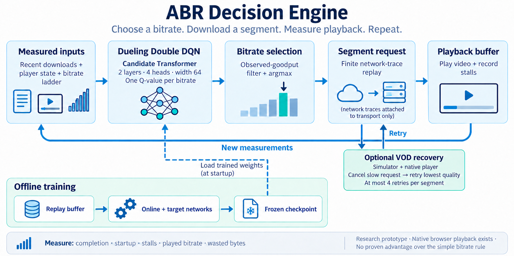

# ABR Decision Engine

A research prototype that chooses video quality from recent download measurements,
playback state, and the available bitrate ladder. The goal is smooth playback:
**higher quality is useful only when startup delay and stalls stay acceptable.**

The project includes a streaming simulator, PPO and Dueling Double DQN trainers,
recorded experiments, and a local browser player. It does not yet show an advantage
for the learned policy over the simple bitrate rule used in the comparisons.



The illustration shows the current workflow, not a benchmark or a player screenshot.
Its [original prompt](docs/images/abr-working.prompt.txt) and [native-label edit](docs/images/abr-working-native.prompt.txt) are included.

## Current results

| Experiment | Observed result | What it means |
| --- | --- | --- |
| [Filtered DQN](runs/dqn-safe/training_report.md) | Higher bitrate than fixed-lowest on the recorded cases, with zero stalls; a matching rule made the same choices | No learned-policy advantage established |
| [Learning comparison](runs/learning-ablation/report.md) | Six runs, 720 training episodes; reward-credit and queue-summary changes did not beat the rule | Keep the frozen baseline |
| [Request recovery](runs/request-recovery/report.md) | Both previously failed videos finished; full-playback stalls were **21.58 s and 9.93 s** | Completion improved, but both missed the 8 s stall limit |
| [Buffer experiment](runs/buffer-experiment/report.md) | 162 replay episodes; four additional sessions already had zero stalls with default buffers | Larger buffers added startup delay without reducing stalls on those four sessions |
| Buffer changes on the earlier failures | Startup threshold 4 s, resume threshold 1 s reduced stalls to **21.02 s and 6.56 s** | One difficult session still failed the stall limit |
| [Long-stall diagnosis](runs/stall-diagnosis/report.md) | The 30 s buffer contract needs at least **19.11 s of stalls** on the remaining case when startup is limited to 3 s | A PPO/DQN swap alone cannot meet the 8 s target; a 60 s prefetch-cap diagnostic removed stalls on this one session |
| [Frozen 60 s validation](runs/prefetch-validation/report.md) | Four more sessions, 30 simulator episodes and eight native trials; two new sessions had excessive startup, and two browser runs timed out | Playback gates failed; no retraining or default change. Browser memory and discarded downloads are recorded |
| [Native recovery](runs/native-recovery/report.md) | All six recovery-on browser runs finished; both recovery-off hard controls timed out. Hard-case stalls were **0.00 s for DQN / 0.15 s for the rule** | Request recovery works on these development cases; 29 s and 8 s startup waits still need smaller startup media |
| [Real startup media and matched training](runs/startup-ladder/report.md) | A real 8 kbps / 96x54 rung cut the known native startup cases below 3 s; a second video also played. Three new 120-episode seeds were tested on four unused sessions | Every trained seed lost to the rule on transfer reward. One new session still had about 10.35 s startup; no promotion |
| [Single-task VOD quality screen](docs/research/single_task_vod_study.md) | Frame-aligned VMAF scored 64 frozen simulator cases across two videos and four ferry sessions, including BOLA-Basic | The old DQN exactly matched the highest-allowed rule; newer DQNs lost or tied. BOLA-Basic beat the rule on Envivio but lost on Sintel. No model promotion |
| [Independent-route BOLA-FINITE diagnostic](docs/research/single_task_vod_study.md#independent-route-bola-finite-diagnostic) | Finite BOLA, fixed BOLA, safety-filtered variants, highest-allowed rule, and frozen DQN on two route-held-out Ghent LTE sessions | Finite BOLA had the best unfiltered bitrate-proxy reward; the safety-filtered result was worse. Two routes, no VMAF, and a changed DQN candidate set are diagnostic only |
| [RobustMPC head-to-head](docs/research/single_task_vod_study.md#robustmpc-head-to-head) | Five-chunk RobustMPC versus frozen DQN and highest-allowed rule on those two Ghent sessions | RobustMPC matched the rule on all decisions; the DQN differed once per route. Diagnostic only: previously viewed test traces, high-service routes, no VMAF |
| [DQN training-budget comparison](docs/research/training_budget_decision.md) | 120 versus 240 episodes across three matched seeds, followed by a frozen 32-session Ghent holdout; selected checkpoints and action sequences were identical across budgets | More training did not help; the follow-up controlled-capacity study is summarized below |
| [Controlled-capacity transfer study](docs/research/controlled_capacity_transfer.md) | Scenario-trained and VMAF-reward DQNs versus log-reward DQNs, highest-allowed, and five-chunk RobustMPC across three frozen stress-profile sets and two contents | VMAF reward reduced seed 13’s collapse but moved seed 11 the other way. No repeatable gain over highest-allowed; stop training this DQN baseline |
| [Learned throughput predictor study](docs/research/throughput_predictor_study.md) | Supervised p20 forecast feeding RobustMPC, evaluated on synthetic v4 profiles and 32 measured historical Ghent sessions | Better forecast error than harmonic estimation, but playback tied highest-allowed on 31/32 sessions with no stall benefit; do not train further without new, lower-service measured traces |

**Current project status: pause model training and promotion.** The DQN,
VMAF-reward DQN, BOLA, RobustMPC, and learned-throughput-predictor studies do
not establish a repeatable playback advantage over the highest-allowed rule.
Keep the frozen DQN as the existing model reference and highest-allowed as the
simple policy reference. Resume model work only after collecting new measured
network traces with recorded RTT and sustained service near or below the video
bitrate ladder. The available measured traces are historical and most sessions
did not create a stall trade-off.

The buffer study also found that larger resume buffers sometimes reduced the
number of pauses while increasing total stall duration. The default buffer
settings remain unchanged.

The recent experiments require every video to finish, startup to stay at or below
3 seconds, and total stalls to stay at or below 8 seconds. Training acceptance
also checks the per-validation-trace throughput baseline. Partial-playback metrics
are retained and explicitly distinguished from full-video results.

The startup-media/training audit records **157 passing tests** and two existing
Gymnasium warnings about infinite observation-space bounds. Later research
experiments were checked with compilation and artifact-integrity checks; the
full test suite was not rerun after those changes. See the
[startup-media/training audit](runs/startup-ladder/verification.json).

## How it works

1. **Observe:** the default DQN path collects eight recent download rows, five
   player-state values, public stream settings, and the available representations.
2. **Score:** the frozen Dueling Double DQN returns one action value per bitrate.
3. **Filter and choose:** an observed-goodput rule masks higher bitrates before
   taking the highest remaining score. The lowest bitrate remains available.
4. **Download and play:** request the selected segment, advance the buffer and
   playback clocks, and record startup, stalls, played quality, and bytes.
5. **Repeat:** use the new measurements for the next segment decision.

The default action filter requires at least 12 seconds of buffered video before
higher bitrates are eligible. It limits their nominal bitrate to 0.65 times the
harmonic mean of recent measured goodput. This is a heuristic, not a stall guarantee.

Optional VOD request recovery can cancel a slow higher-quality body and retry
that same segment at the lowest quality. It allows at most four retries per
segment. Failed bodies are discarded in full; RTT, backoff, bytes and stalls all
count. Recovery is available in the simulator and opt-in in the native player
with `--enable-request-recovery`. See [native recovery](docs/native-recovery.md)
and the [initial simulator experiment](docs/request-recovery.md).

### Model and training

The current baseline uses a **77,826-parameter Candidate Transformer**:

```text
History [8,5] ──────────────────────────────┐
Player state [5] + stream settings [10] ────┼─> 64-wide tokens
Bitrate candidates [K,3] ──────────────────┘          │
                                      2 Transformer encoder layers
                                      4 attention heads, FFN 128
                                                    │
                                state value V(s) + candidate advantages A(s,a)
                                                    │
                                Q(s,a) = V(s) + A(s,a) - mean(A)
                                                    │
                                observed-goodput mask -> argmax -> bitrate
```

The mean uses valid candidates only. Candidate inputs contain nominal bitrate,
estimated segment size, and duration. Future trace bandwidth is not a model input.
Optional queue-summary features are a separate research variant and are not enabled
in the native player. Dense, GRU and PPO architectures remain available for comparison.

Dueling Double DQN trains from stored transitions. The online network chooses
the next action; a separate target network scores it for the learning target.
Training periodically refreshes the target network and evaluates checkpoints
on validation traces. Playback uses frozen weights and does not update them online.
The reward uses played log bitrate with explicit penalties, including stalls;
recent experiments use a rebuffer penalty of 12. Bitrate is a quality proxy,
not measured visual quality or a human opinion score.

Current browser/recovery experiments load
[`runs/learning-ablation/baseline-seed-7/accepted.npz`](runs/learning-ablation/baseline-seed-7/accepted.npz).
Its tensors exactly match the earlier accepted controller; see
[checkpoint identity](runs/learning-ablation/control_identity.json).
NPZ checkpoints disable pickle loading and validate model source, shapes and
feature contracts. Changing model code can require explicit checkpoint migration.

## Run locally

Python 3.12 is the currently verified environment. PyTorch is optional for the
simulator and required for model training and inference.

```bash
python3 -m venv .venv
source .venv/bin/activate
python -m pip install -r requirements-dev.txt -r requirements-model.txt
python -m pytest -q
```

Replay the recent experiments with the recorded datasets and frozen checkpoint:

```bash
python -m scripts.evaluate_request_recovery
python -m scripts.prepare_buffer_experiment
python -m scripts.evaluate_buffer_experiment
```

The buffer preparation command reuses the committed raw traces. If a raw file
is missing, it downloads it from the original archive. These commands overwrite
the corresponding reproducible reports under `runs/`; they do not retrain the model.

For an environment-only diagnostic:

```bash
python -m abr.benchmark --dataset data/hard_envivio/dataset.json --mode vod --split validation --baseline throughput --output runs/local-throughput.json
```

The separate trainers expose their options through:

```bash
python -m abr.models.train_dueling_dqn --help
python -m abr.models.train_ppo --help
```

### Local browser playback

Download and verify the original media once, then start the local server:

```bash
python -m scripts.download_player_media
python -m abr.player_server
```

Open **http://127.0.0.1:8787**. The player uses native Media Source Extensions
and real H.264 fragments. Its video cache is about 275 MB under ignored
`artifacts/player-media/`. Downloading requires network access.

Each session has its own finite trace clock. HTTP bodies are paced in 16 KiB
chunks, with an assumed RTT. This is application-throughput pacing, not a packet
or radio emulator. The player is a local video-only research harness. Seeking,
audio and production DASH integration are outside the current experiment.
See [player instructions and capture checks](experiments/validation/POLICY_PLAYER.md).

## Data and limits

- The original realistic VOD is one Envivio video, 49 segments and six bitrate
  levels: 300, 750, 1200, 1850, 2850 and 4300 kbps. Segment byte sizes come from
  the published media; the local player verifies its cached fragments.
- `data/hard_envivio/` contains the main Norway HSDPA experiment: fourteen measured
  sessions grouped by route, plus four explicitly synthetic outage profiles.
- `data/learning-holdout/` contains the two additional sessions that exposed the
  request failures. They are now development cases, not untouched final tests.
- `data/buffer-sessions/` contains four further ferry sessions. Dates and nine
  buffer profiles were fixed before download/replay. All profiles share these
  sessions; selecting a winner from them needs separate confirmation.
- `data/realistic_envivio/` retains the earlier pilot with eight Ghent 4G logs.
  Both measured collections are old network data, not a modern-network benchmark.
- `data/startup-ladder/` and `data/sintel-ladder/` contain actual re-encoded media
  sizes/timings for seven rungs, including a deliberately very-low-quality 8 kbps
  fallback. Sintel is a second, 52.2-second content example, never used in training.
  See [asset preparation and attribution](docs/startup-ladder.md).
- `data/transfer-sessions/` contains four unused-session tests. The three new
  checkpoints were fixed from validation before scoring these sessions/content.
- `data/ghent-holdout/` contains 32 historical measured Ghent 4G sessions. They
  were held out from the original eight-session pilot, but later used in
  project diagnostics; they are not a current or untouched network benchmark.

The simulator supports finite VOD and a finite low-latency live event using
explicit part metadata. The recent training, recovery and buffer evidence is
**VOD-only**. Traces never repeat. Observed application goodput is not a causal
capacity model. The simulator omits TCP/QUIC behavior, packet loss, radio scheduling,
audio and decoding; the native player adds real decoding but has different timing.

Two content examples and a few route groups do not establish broad generalization. There is
no proven neural advantage, production readiness, or complete simulator/browser
equivalence. The [evaluation protocol](experiments/configs/evaluation_v2.json)
remains a draft; stronger baselines and broader independent data are still needed.

## Repository map

| Location | Purpose |
| --- | --- |
| `abr/env.py`, `transport.py`, `playback.py`, `media.py` | Finite streaming simulator and playback accounting |
| `abr/recovery.py` | Optional bounded VOD request recovery |
| `abr/mp4.py`, `abr/startup_training.py` | Generated-media timing extraction and fixed matched training experiment |
| `abr/models/` | Model architectures, checkpoints, inference, PPO and DQN trainers |
| `abr/benchmark.py`, `trace_import.py`, `validate_player.py` | Replay, trace import and player comparison tools |
| `abr/player_server.py`, `experiments/validation/` | Local native player and independent capture tooling |
| `scripts/` | Input preparation, measured experiments and capture audits |
| `data/`, `runs/` | Selected trace inputs, provenance, frozen checkpoints and reports |
| `docs/`, `tests/` | Explanations, generated working diagram and verification |

## Next investigation

The [safety-gate diagnosis](runs/quality-gate-diagnosis/report.md) found that the
model preferred an upgrade in all 140 examined emergency decisions, but the
safety filter blocked it. In 78 simulator rollouts, lowering only the buffer
threshold from 12 s to 4 s reduced emergency exposure by 12.1% per policy without
added stalls or startup delay. Seven of thirteen video/session cases still fail
the draft quality limits. The [native Chrome comparison](runs/native-quality-gate/report.md)
then completed eight playbacks with zero stalls and no discarded downloads.
Emergency exposure fell from 16 s to 8 s in the selected upgrade case on each
video; the slow-network case did not improve. Only one of four candidate runs
met the draft quality limits, and one case had lower mean bitrate. Defaults
remain unchanged. The [throughput diagnosis](runs/throughput-diagnosis/report.md)
then confirmed about 20 s of stale-estimate delay in the long video. The short
video finished downloading before network recovery. Shorter safety histories
helped some traces but worsened a controlled validation case by 64 s of emergency
quality, so no estimator was promoted. The subsequent
[buffer-aware recovery experiment](runs/buffer-aware-recovery/report.md) completed
96 simulator rollouts and eight native playbacks. It improved the intended
recovery, but added 16 s of emergency quality on a transfer case and 12 s on a
native controlled case, losing a quality pass. The candidate was rejected for
promotion; its research adapter is opt-in, with model weights and defaults unchanged.

The [real startup-ladder experiment](docs/startup-ladder.md) completed the next
media, native-playback, second-video and matched-training checks. It fixes known
startup cases by reducing the first media fragment to 5,478 bytes, with a major
visual-quality tradeoff. One unused session supplies only about 1.1 KB by 3 s and
still misses the startup limit. New learned checkpoints did not outperform the
rule on transfer, so defaults remain unchanged.

The [production readiness profile](docs/production-readiness.md) now proposes an
Apple M2 / 8 GiB / desktop Chrome reference target, a 1.5 GiB browser budget plus
512 MiB for inference, and a normal quality floor of 180p / 300 kbps. These are
draft limits, not approved requirements. Existing captures fit the sampled memory
limits but all eight fail the proposed emergency-quality exposure limits.
Production approval still needs full-stack memory and soak measurements, visual
acceptance, and a network-conditioned startup requirement.
The desktop prototype is runnable; universal startup guarantees and a neural
advantage are not established. Offline future-service bounds must never become
policy inputs.

## Background

The project was extracted from the author's `DASH_RL` work at commit
`970c67ec015cfc27968b78bb09db243fb95da08a`. The decision interface was inspired by
[Laya](https://github.com/NandhaKishorM/laya); no language encoder or weights are used.
Neural ABR already exists in prior work such as
[Pensieve](https://web.mit.edu/pensieve/content/pensieve-sigcomm17.pdf). The
[research note](docs/research/decision_model_and_training_environment.md) records
the background and evaluation gaps.
